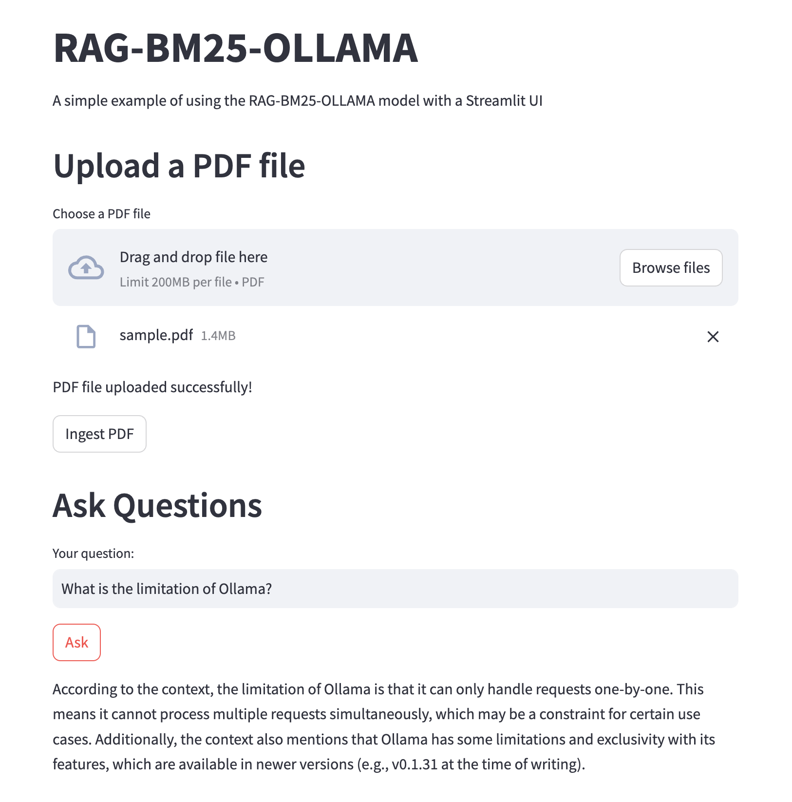

# Simple RAG

A minimal, self-implemented RAG (Retrieval-Augmented Generation) pipeline for answering questions over PDF documents. This package contains four modules:

- **Data Helper**: loads text from PDF files.
- **Retrieval**: finds the most relevant chunks from a corpus (BM25).
- **Rerank**: re-scores retrieved chunks with a cross-encoder.
- **LLM**: generates the final answer (Ollama, OpenRouter, or Gemini).

## Overview

The pipeline flow is:

1. **Ingest** - `PDFReader` extracts text from PDFs and `text2chunk` splits it into overlapping word chunks.
2. **Retrieve** - `BM25Retrieval` selects the top candidates for a query.
3. **Rerank** - `CrossEncoderRerank` re-scores candidates and keeps the best few.
4. **Generate** - an LLM backend writes the answer from the retrieved context.



## Features

- Local LLM support via **Ollama** (no API key required).
- Cloud LLM support via **OpenRouter**.
- CLI examples plus a **Streamlit** web UI for uploading PDFs and asking questions.
- `start.py` launcher that sets up the virtualenv, checks dependencies, auto-detects the backend, and starts the CLI or UI.
- Configurable chunk size, overlap, retrieval depth, and rerank depth.

## Prerequisites

- Python 3.10 or newer (3.11 recommended; the pinned dependencies do not support 3.14).
- Poppler (required to build the `pdftotext` package).
- One LLM backend:
  - Ollama with `llama3:instruct` (local), or
  - An OpenRouter API key (cloud), or
  - A Google API key (the Gemini provider is currently unmaintained; see [Troubleshooting](#troubleshooting)).

Install Poppler:

```bash
# macOS
brew install pkg-config poppler

# Debian/Ubuntu
sudo apt install build-essential libpoppler-cpp-dev pkg-config python3-dev

# Fedora/RHEL
sudo yum install gcc-c++ pkgconfig poppler-cpp-devel python3-devel

# Windows (using conda)
conda install -c conda-forge poppler
```

## Quick start

```bash
git clone https://github.com/ssantoshhhhh/simple-rag.git
cd simple-rag

python3.11 -m venv .venv
source .venv/bin/activate
python -m pip install --upgrade pip
pip install -r requirements.txt
pip install -e .
```

Then start the project with the launcher:

```bash
python start.py
```

`start.py` re-executes itself inside `.venv`, verifies dependencies, auto-detects Ollama or OpenRouter, and launches the matching CLI example. Useful flags:

| Flag | Description |
| --- | --- |
| `--backend auto\|ollama\|openrouter` | Choose the LLM backend (default: auto-detect). |
| `--ui` | Launch the Streamlit web UI instead of the CLI. |
| `--install` | Install missing Python dependencies automatically. |
| `--force` | Continue even if the expected Ollama model is missing. |

### Set up an LLM backend

**Option A - Ollama (local):**

```bash
brew install ollama
brew services start ollama
ollama pull llama3:instruct
```

**Option B - OpenRouter (cloud):**

Create a `.env` file in the project root (it is gitignored):

```bash
OPENROUTER_API_KEY=your_key_here
OPENROUTER_MODEL=meta-llama/llama-3.1-8b-instruct
```

See `.env.example` for the available variables.

## Running the examples

### CLI with Ollama

```bash
python examples/simple_rag_bm25_ollama.py
```

The script loads `examples/sample.pdf`, runs a sample query, then waits for your questions. Press `Ctrl-D` or `Ctrl-C` to exit.

### CLI with OpenRouter

```bash
python examples/simple_rag_bm25_openrouter.py
```

### Web UI with Streamlit

The UI currently supports Ollama only:

```bash
streamlit run examples/simple_rag_bm25_ollama_ui.py
```

Upload a PDF, click **Ingest PDF**, then ask questions.



### Use your own PDF

Change the `sample_pdf` path in the example script:

```python
sample_pdf = "/absolute/path/to/your/document.pdf"
```

Or upload it through the Streamlit UI.

### Quick non-interactive test

```bash
printf 'What can Ollama do?\n' | python examples/simple_rag_bm25_ollama.py
```

A healthy run prints `Number of chunks: ...`, a sample answer, and then exits.

## Using the library

```python
import os

from rag.data_helper import PDFReader
from rag.llm import OllamaLLM
from rag.pipeline import Answer, SimpleRAGPipeline
from rag.rerank import CrossEncoderRerank
from rag.retrieval import BM25Retrieval
from rag.text_utils import text2chunk

sample_pdf = os.path.join(os.path.dirname(__file__), "sample.pdf")
contents = PDFReader(pdf_paths=[sample_pdf]).read()
text = " ".join(contents)
chunks = text2chunk(text, chunk_size=200, overlap=50)
print(f"Number of chunks: {len(chunks)}")

retrieval = BM25Retrieval(documents=chunks)
llm = OllamaLLM(model_name="llama3:instruct")
rerank = CrossEncoderRerank(model_name="cross-encoder/ms-marco-MiniLM-L-6-v2")
pipeline = SimpleRAGPipeline(retrieval=retrieval, llm=llm, rerank=rerank)

response: Answer = pipeline.run("What can Ollama do?")
print(response.answer)
```

Swap `OllamaLLM` for `OpenRouterLLM()` to use OpenRouter; it reads `OPENROUTER_API_KEY` and `OPENROUTER_MODEL` from the environment (or a `.env` file).

## Environment variables

| Variable | Used by | Description |
| --- | --- | --- |
| `OPENROUTER_API_KEY` | `OpenRouterLLM` | Required for the OpenRouter backend. |
| `OPENROUTER_MODEL` | `OpenRouterLLM` | Model name, e.g. `meta-llama/llama-3.1-8b-instruct`. |
| `GOOGLE_API_KEY` | `GeminiLLM` | Gemini API key (provider currently unusable, see below). |

## Tuning

| Setting | Location | Effect |
| --- | --- | --- |
| `chunk_size` | example scripts, `text2chunk(...)` | Words per chunk. Larger chunks keep more context but make retrieval less precise. |
| `overlap` | example scripts, `text2chunk(...)` | Words shared between adjacent chunks. Prevents splitting answers across boundaries. |
| `retrieval_top_k` | `SimpleRAGPipeline(...)` | Number of BM25 candidates passed to the reranker. Default is 100. |
| `rerank_top_k` | `SimpleRAGPipeline(...)` | Number of chunks sent to the LLM. Default is 3. |
| `model_name` | reranker | Cross-encoder model. Default is `cross-encoder/ms-marco-MiniLM-L-6-v2`. |

## Project structure

```text
simple-rag/
├── start.py                        # launcher: venv, deps, backend detection
├── examples/
│   ├── sample.pdf
│   ├── simple_rag_bm25_ollama.py       # CLI, local Ollama
│   ├── simple_rag_bm25_ollama_ui.py    # Streamlit UI, local Ollama
│   └── simple_rag_bm25_openrouter.py   # CLI, OpenRouter
├── rag/
│   ├── data_helper.py              # PDF reading
│   ├── llm.py                      # Ollama, OpenRouter, Gemini providers
│   ├── pipeline.py                 # retrieve -> rerank -> generate
│   ├── prompt.py                   # prompt template
│   ├── rerank.py                   # cross-encoder reranker
│   ├── retrieval.py                # BM25 retrieval
│   └── text_utils.py               # chunking
├── test/
├── .env.example
├── requirements.txt
└── setup.py
```

## Troubleshooting

**`ERROR: Could not build wheels for pdftotext`**
Poppler or pkg-config is missing. Install it as shown in [Prerequisites](#prerequisites) and retry.

**Dependencies fail to install on Python 3.14**
Several pinned packages (torch, sentence-transformers) do not support 3.14. Use Python 3.11.

**Ollama request times out or returns an empty answer**
Make sure the server is running and the model exists:

```bash
brew services start ollama
ollama list
```

The examples expect the model name `llama3:instruct` exactly.

**OpenRouter returns `0 endpoints out of N requested are available`**
Your account privacy settings (ZDR) block the requested model's endpoints. Either change the privacy settings at https://openrouter.ai/settings/privacy or choose another `OPENROUTER_MODEL`.

**`ValueError: Please set GOOGLE_API_KEY` or a Gemini model error**
`GeminiLLM` currently references the invalid model name `text-davinci-003`, so the provider does not work. Use Ollama or OpenRouter until it is fixed.

For a full step-by-step setup guide, see [GETTING_STARTED.md](GETTING_STARTED.md). More examples are available in [examples](examples).
